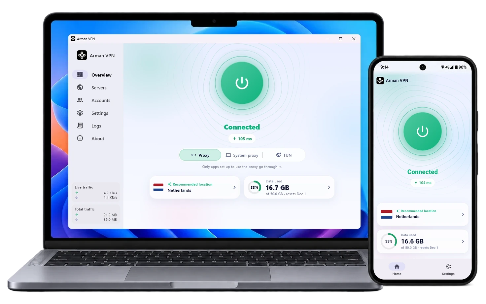
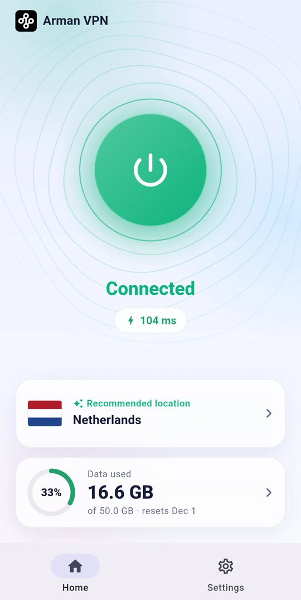
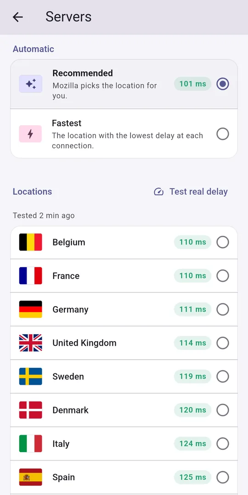
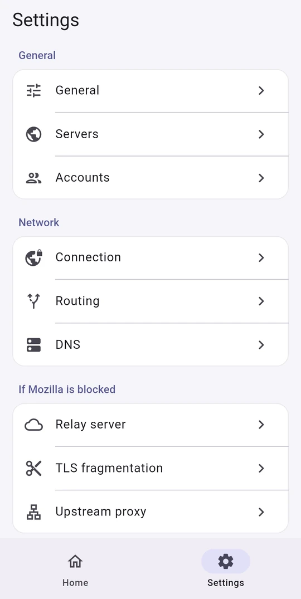
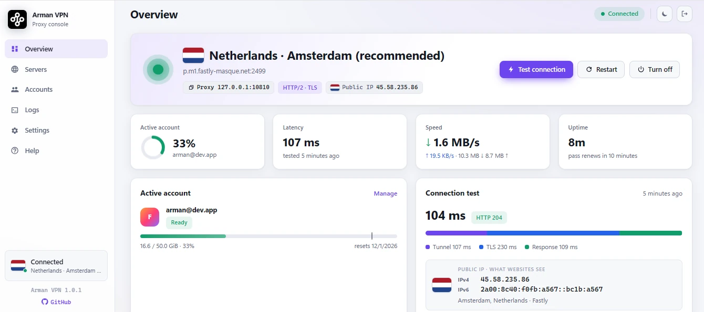

<div align="center">

**🇺🇸 English** &nbsp;/&nbsp; [🇨🇳 简体中文](docs/readme/README_zh.md) &nbsp;/&nbsp; [🇷🇺 Русский](docs/readme/README_ru.md) &nbsp;/&nbsp; [🇮🇷 فارسی](docs/readme/README_fa.md)

</div>
<br>

<p align="center"></p>

<h1 align="center">VPNSOPR</h1>

<h2 align="center">⚠️ Unofficial project</h2>

> VPNSOPR is an independently modified fork of [armanlife/arman-vpn-client](https://github.com/armanlife/arman-vpn-client). Original copyright notices and the GPL-3.0 license are retained.

<h3 align="center">Arman VPN is an independent project. It is not made, owned, sponsored, or endorsed by Mozilla, and is not affiliated with Mozilla in any way. See the <a href="#disclaimer">disclaimer</a>.</h3>

<div align="center">

[](https://github.com/armanlife/arman-vpn-client/releases)
[](https://github.com/armanlife/arman-vpn-client/releases/latest)
[](LICENSE)

</div>

## What is VPNSOPR?

**VPNSOPR** is a rebranded fork of the original open-source VPN client that works with a Firefox Account. It carries your internet traffic through Mozilla's servers, on **Fastly**'s infrastructure, over secure **HTTP/2 and HTTP/3** tunnels.

For **Android, Windows, macOS, and Linux**; completely free, with no ads.

<p align="center"><a href="https://raw.githubusercontent.com/armanlife/arman-vpn-client/main/docs/screenshots/main.webp" target="_blank"></a></p>

## 🚀 Main features

✈️ Cross-platform: Android, Windows, macOS, and Linux

📺 Android TV: works with the remote control

⭐ Very easy to use, with a simple interface

🆓 Free: 50 GB a month for every Firefox Account

🌐 Mozilla's servers: choose a country with a ping test, or let the app pick the best server

⚡ Fast, stable connections over HTTP/2 and HTTP/3

🔀 Smart routing (split tunneling): choose the sites and apps that skip the VPN

🧱 If your network blocks the connection: TLS fragmentation, upstream SOCKS5 proxy, and a relay server

🔒 Encrypted DNS (DNS over HTTPS)

🌍 15 languages, including English, Persian, Chinese, and Russian

🌙 Light and dark themes

🛡 Open source, secure, and community-driven

🔄 Automatic updates

## 📸 Screenshots

<p align="center">
&nbsp;&nbsp;
&nbsp;&nbsp;

</p>

## 📥 Download

No VPNSOPR release binaries have been published yet. Build this fork from source using the instructions in `app/README.md` and `core/README.md`. Do not install the upstream project's release files as VPNSOPR builds.

## 💻 Install and update on Linux and macOS

> Windows and Android users don't need this section: take the installer from the "Download" table above.

```bash
curl -fsSL https://raw.githubusercontent.com/armanlife/arman-vpn-client/main/install.sh | bash
```

### 🌐 Web panel

For Linux servers, Arman VPN has a **web panel** that opens in any browser and has everything the app has: managing accounts and data, choosing a server and testing delay, the connection test, the live log, and every setting.

<p align="center"></p>

- **Panel address:** `http://SERVER-IP:10820/app/`, with a username and password. The exact address is shown at the end of the install.
- **Proxy:** SOCKS5 and HTTP on port `10810`, with a username and password of its own.

### ⌨️ Managing from the terminal

On the server, run `sudo arman-vpn` to open the management menu:

```text
$ sudo arman-vpn

  Arman VPN
  ────────────────────────────────────────────────────────────────────────────
    Service     ● running
    Autostart   on
  ────────────────────────────────────────────────────────────────────────────
   0) Exit
  ────────────────────────────────────────────────────────────────────────────
   1) Update                                   arman-vpn update
   2) Uninstall                                arman-vpn uninstall
  ────────────────────────────────────────────────────────────────────────────
   3) Set panel login                          arman-vpn panel
   4) View panel info                          arman-vpn panel-info
  ────────────────────────────────────────────────────────────────────────────
   5) Status                                   arman-vpn status
   6) Start                                    arman-vpn start
   7) Stop                                     arman-vpn stop
   8) Restart                                  arman-vpn restart
   9) Show the log                             arman-vpn logs
  ────────────────────────────────────────────────────────────────────────────
  10) Enable autostart                         arman-vpn enable
  11) Disable autostart                        arman-vpn disable
  ────────────────────────────────────────────────────────────────────────────
  12) Add a Firefox Account                    arman-vpn add-account
  13) List the accounts                        arman-vpn list-accounts
  ────────────────────────────────────────────────────────────────────────────
  Enter a number [0-13]:
```

## OpenWrt routers

To install on an OpenWrt router, see the [OpenWrt guide](docs/OPENWRT.md).

## Known limitations

<details>
<summary>What Mozilla's servers do not carry</summary>

- **TCP:** ports 80, 443, 8080, and 8443 only. Other ports, such as mail (25, 465, 587, 993) and SSH (22), are refused. Git over SSH to GitHub is the exception: it goes through port 443 by itself.
- **UDP:** ports 80, 443, 3478, 8080, 8443, and 49152-65534 only. Calls and games on other ports do not go through. Browsers and most apps work normally.

</details>

## Disclaimer

This app is an independent, unofficial client, made and maintained by its own developer. It is not a Mozilla product: Mozilla did not make it, does not own, sponsor, or endorse it, and has no part in its development or support. Questions and problems about the app belong in this repository, not with Mozilla.

You sign in with your own Mozilla account. The account's terms, data limit, and availability are set by Mozilla. Your password and sign-in tokens stay on your device.
